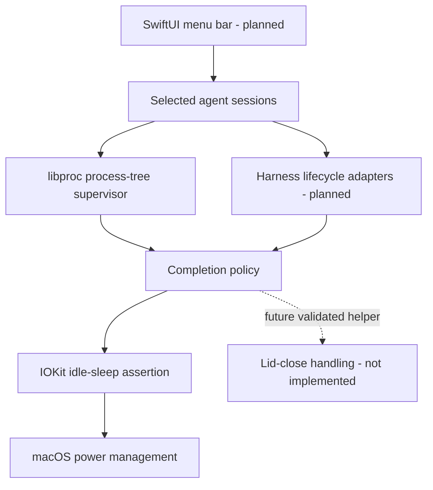

# LidHarbor

**Prototype status: experimental. Not a finished menu-bar app.**

A native Swift prototype for supervising local AI agent process trees and coordinating macOS idle-sleep assertions. Its long-term goal is a lightweight menu-bar app where users select sessions (e.g. Hermes or Codex) that should remain active while the screen is off.

## What's actually included
- `MacProcessSupervisor`: reads macOS process list via `libproc` and follows descendants from a chosen PID (macOS only, not yet compiled on macOS).
- `IdleSleepAssertion`: creates/releases a documented IOKit *idle sleep* assertion (macOS only, not yet compiled on macOS).
- `CompletionPolicy`: will not treat low CPU, or a missing lifecycle signal, as task completion.
- Four unit tests for completion gating, run successfully on Linux Swift 6.
- Read-only CLI demo listing Hermes/Codex candidates; optional 30-second assertion demonstration.

## What it does NOT do yet
- **Does not keep a closed-lid MacBook awake.** A normal idle-sleep assertion does not override lid-close sleep. A separately validated mechanism and watchdog are required.
- No completed SwiftUI menu-bar UI or signed privileged helper.
- No harness lifecycle adapters, verified PID/start-time process identity, resource sampling, adaptive scheduler, or automatic sleep release integration yet.
- macOS-specific code has **not** been compiled or tested on Apple hardware; compatibility issues may remain.

## Build on macOS

```sh
swift test
swift run lidharbor-demo
swift run lidharbor-demo --assert-30
```

On non-macOS platforms, the CLI explains its limitation and only the platform-independent policy is exercised. Run on a disposable test workflow first; it does not modify system `pmset` settings.

## Proposed architecture



## Security and reliability principles
- Never execute arbitrary agent-provided commands with elevated rights.
- Never infer task completion from a sleeping CPU or low RSS.
- Treat PID alone as an ephemeral identifier; match process start time, UID and executable before any future process management.
- Make sleep inhibition bounded, observable, reversible, and fail-safe.

## Roadmap
1. Confirm the macOS-specific prototype compiles on Apple Silicon and add hardware integration tests.
2. Build stable process identity and process metrics; unit-test descendant tracking.
3. Add Hermes lifecycle event integration, then other harness adapters.
4. Add native menu-bar UI and explicit session selection.
5. Research and validate lid-close sleep control and crash-safe restoration before enabling that mode.

This repository contains original code and documents prepared for this project; it does not claim external projects as implementation evidence.
